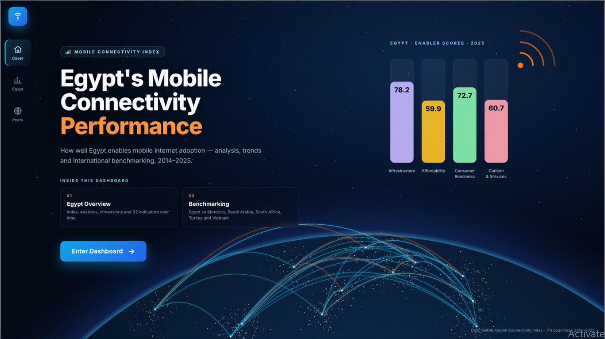
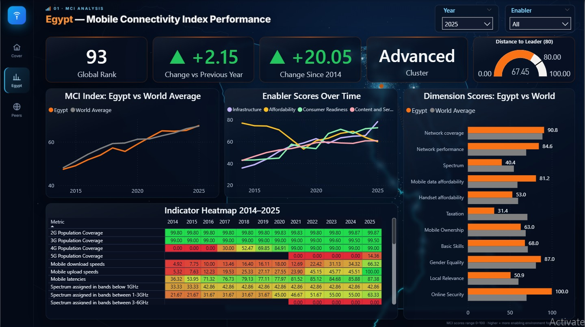
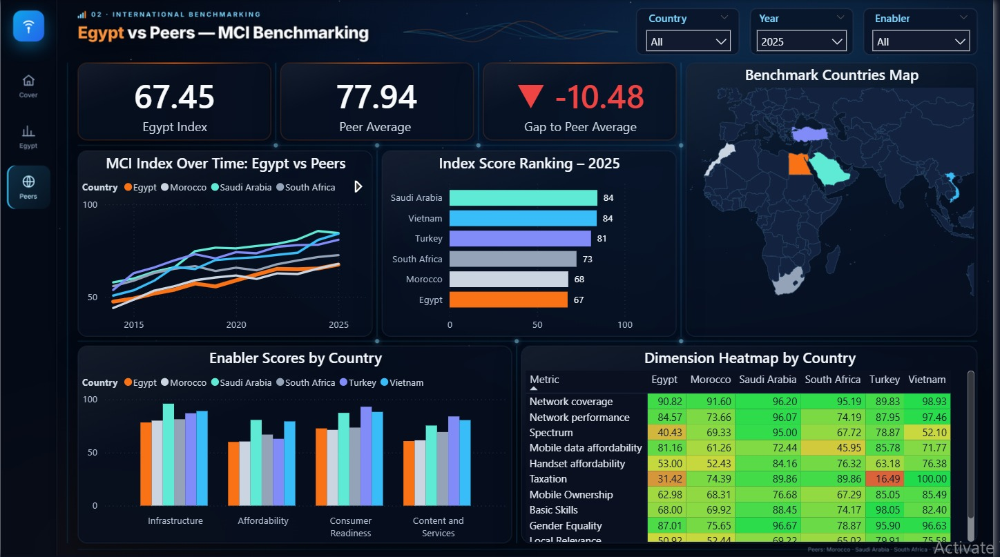
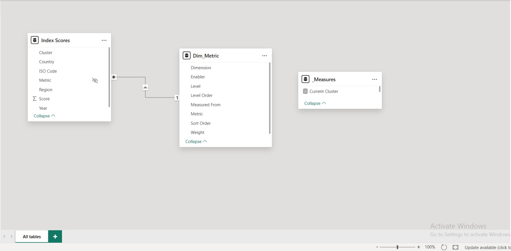
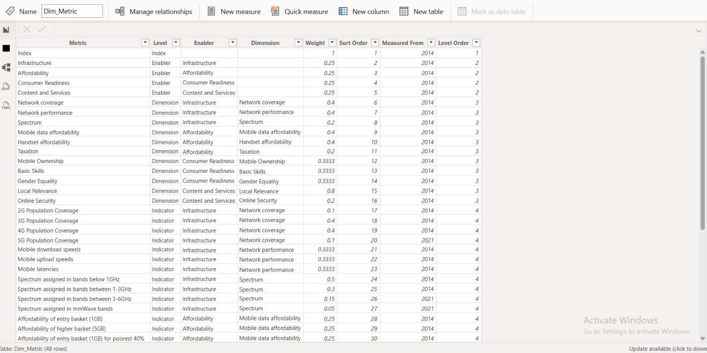
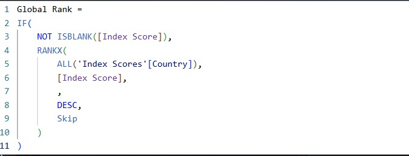

# 📶 Egypt's Mobile Connectivity Performance — Power BI & Data Analysis


An end-to-end analysis of **Egypt's performance in the GSMA Mobile Connectivity Index (MCI)** from 2014 to 2025, with an interactive Power BI dashboard, an international benchmark against five countries, and policy recommendations.



---

## 🎯 Questions

1. How has Egypt's MCI score evolved from 2014 to 2025?
2. What are Egypt's main strengths and weaknesses?
3. How does Egypt compare with relevant countries?
4. Which actions would close the gap?

---

## 📊 Key Results

| Metric | Value |
|---|---|
| MCI score (2025) | **67.45**, Advanced cluster |
| Global rank (2025) | **#93 of 174** (best was #84 in 2022) |
| Change since 2014 | **+20.1 points**, slightly faster than the world (+19.1) |
| World average (2025) | 67.2, so Egypt is at the world level |
| Average of 5 peers (2025) | 77.9 |
| Gap to peers | **−10.5 points**, up from −5.0 in 2014 |

**The paradox.** Egypt improved by 20 points and reached the world average, but its peers grew faster (+25.6 on average), so the gap with them more than doubled.

---

## 💪 Strengths and ⚠️ Weaknesses

| Strengths | Weaknesses |
|---|---|
| **Network performance** rose from 15.5 to 84.6 | **Taxation** 31.4, ranked #157 of 174 |
| **4G coverage** grew from 0% to 99% | **Spectrum** 40.4, with the 3–6 GHz indicator at 0 |
| **Online security** 100, joint #1 worldwide | **Local relevance** 50.9, digital language support ranked #152 |
| **Mobile data affordability** 81.2, ranked #39 | **Handset affordability** 53.0 |
| **Gender equality** +64.8 points since 2014 | **Affordability** is the only enabler that fell (76.9 → 59.9) |

---

## 🌍 International Benchmark

| Country | Why it was selected |
|---|---|
| 🇲🇦 Morocco | Closest score to Egypt and a similar income level. It was behind Egypt in 2014 and has now overtaken it |
| 🇿🇦 South Africa | An African peer 5 points ahead, with the best handset affordability among top Sub-Saharan countries |
| 🇸🇦 Saudi Arabia | Regional benchmark in the Leader cluster, with the highest spectrum score among Arab Leaders |
| 🇹🇷 Turkey | A Leader whose taxation score is below Egypt's, showing taxation alone doesn't explain the gap |
| 🇻🇳 Vietnam | The biggest gain among countries close to Egypt in 2014 (+33.4), now a Leader |

---

## 🖥️ Dashboard

### Egypt Overview
Rank, yearly change, cluster and distance to the Leader cluster, with trends for the index, the four enablers, the eleven dimensions and all 32 indicators.



### Benchmarking
Egypt against the five peers, from the overall index down to each dimension.



**Interactivity.** Year and enabler slicers, page navigation buttons, and a country tooltip page.

---

## 🛠️ How It Was Built

### 1. Data preparation (Power Query)
- The source sheet had **2,088 rows** (174 countries × 12 years) and **48 score columns**.
- I **unpivoted** the score columns, so each row holds one country, one year, one metric and its score. This lets one slicer switch between any metric.
- Empty cells, mostly 5G indicators before 2021, were **kept as blanks, not zeros**, because zero would mean a real score and would lower the averages.

### 2. Data model (star schema)
- **Index Scores** is the fact table with the scores.
- **Dim_Metric** is a lookup table I built with all 48 metrics, their level (index, enabler, dimension or indicator), parent, weight and GSMA order.
- One-to-many relationship on `Metric`, with single-direction filtering.





### 3. DAX measures
Measures for the rank, yearly change, change since 2014, cluster, world average, peer average and gap. For example, the global rank uses `RANKX` over all countries, with `ALL` removing the Egypt page filter so Egypt is ranked against the world.



---

## 💡 Recommendations

1. **Rebalance taxes on handsets and mobile services**, the largest gap with peers.
2. **Assign spectrum in the 3–6 GHz band and more sub-1 GHz spectrum.**
3. **Expand Arabic digital content** and support local apps.
4. **Make smartphones more affordable** for low-income users.
5. **Expand mobile ownership and digital skills**, including closing the gender gap in mobile internet use.

---

## 📁 Repository Structure

```
Egypt-MCI-Analysis/
├── dashboard/       # Power BI file (.pbix)
├── presentation/    # Slides (PDF and PPTX)
├── data/            # Dim_Metric lookup table
├── images/          # Dashboard and model screenshots
└── README.md
```

---

## 📚 Data Source

[GSMA Mobile Connectivity Index](https://www.mobileconnectivityindex.com/), 2026 release, covering 174 countries from 2014 to 2025. The source data is available on the GSMA website.

**Note.** The data shows what changed, not why. Explaining causes would need further policy research.

---

## 👩‍💻 Author

**Hadeer Hussen Atia**, Data Analyst
